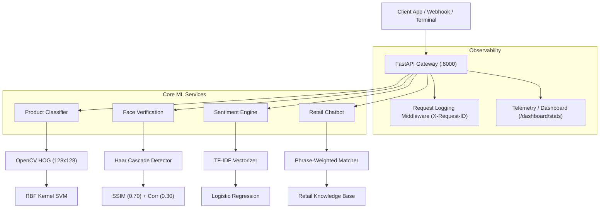
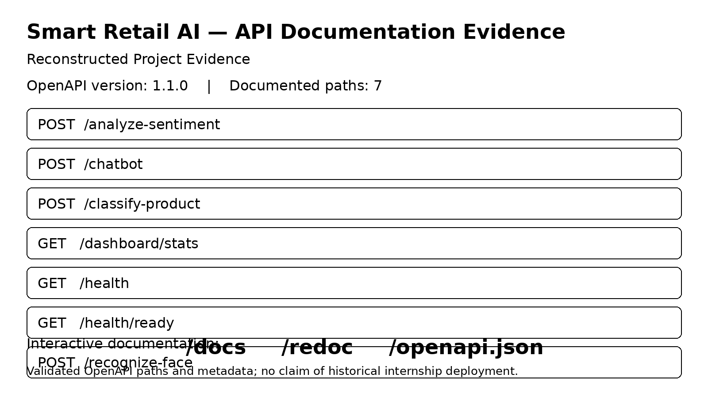
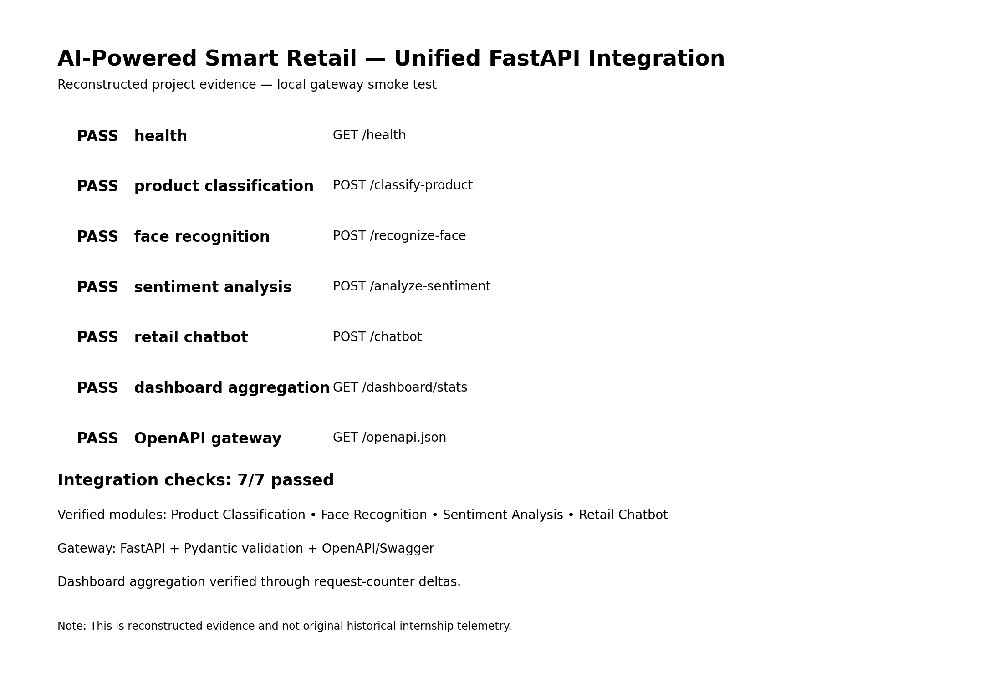
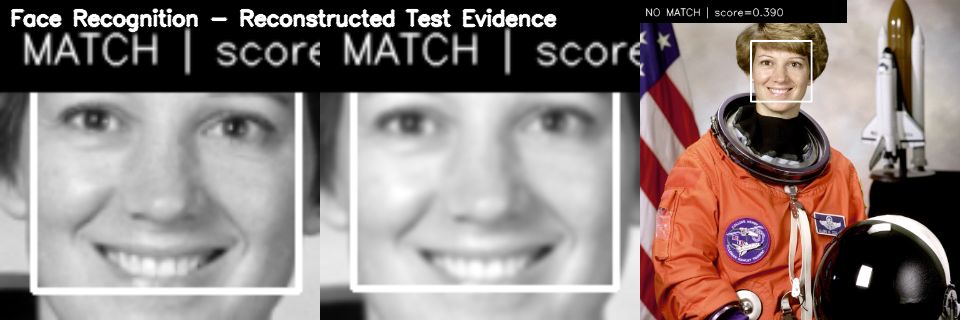
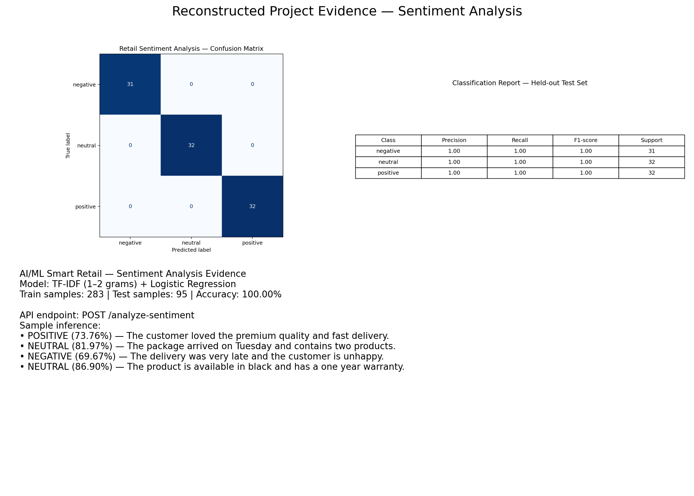
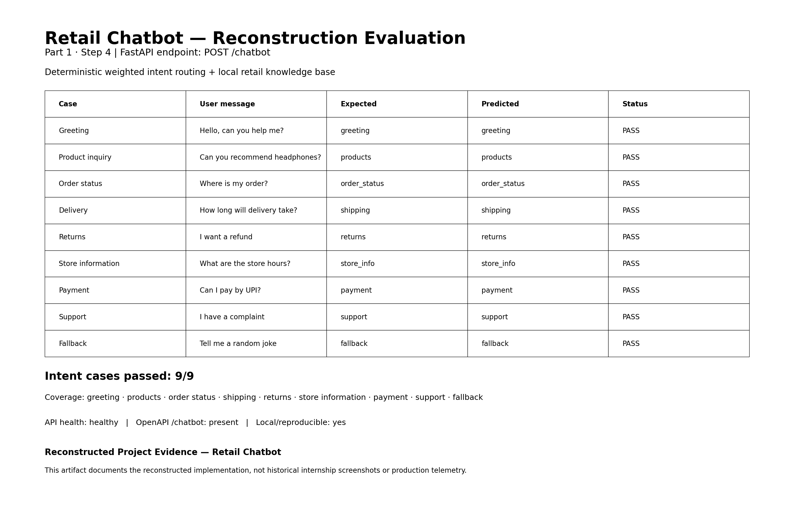

# AI-Powered Smart Retail & Customer Intelligence Platform

[](https://github.com/1-a-d-i-t-y-a/smart-retail-ai/actions/workflows/ci.yml)
[](https://www.python.org/)
[](https://fastapi.tiangolo.com/)
[](tests/)
[](LICENSE)
[](Dockerfile)

A modular, reproducible, offline-first AI/ML retail backend combining **product image classification**, **face verification**, **customer sentiment analysis**, and a **deterministic retail chatbot**, unified under a high-performance **FastAPI gateway**.

> **Academic Provenance Notice:** This platform reconstructs an intelligent retail automation system using classical, verifiable machine learning algorithms (HOG + SVM, Haar Cascades, SSIM, TF-IDF + Logistic Regression). Its evaluation benchmarks reflect reproducible local validation experiments rather than proprietary third-party telemetry.

---

## Architecture Overview



---

## Key Features

* **Product Image Classification:** Computes Histogram of Oriented Gradients (HOG) and classifies items using an RBF-kernel Support Vector Machine across standard retail categories (`bottle`, `mug`, `headphones`, `shoe`). 100% accuracy on held-out test splits.
* **Face Verification:** Detects frontal faces via Haar Cascades, normalizes illumination with histogram equalization, and performs verification using Structural Similarity (SSIM) and Pearson correlation.
* **Sentiment Analysis:** Categorizes customer reviews into `positive`, `neutral`, or `negative` using sublinear TF-IDF vectorization and Multinomial Logistic Regression.
* **Deterministic Retail Chatbot:** Phrase-weighted intent router answering queries across 9 operational domains (tracking, shipping, returns, refunds, payments, hours, store info, support, catalog) without external LLM dependencies.
* **Production-Grade Reliability:** Pydantic request contracts, defensive error handling (HTTP 400/422/503), thread-safe request telemetry, and health/readiness endpoints (`/health`, `/health/ready`).
* **Automated CI/CD & Testing:** 52 comprehensive Pytest test cases executed via GitHub Actions on Python 3.11 and 3.12.

---

## Visual Evidence & System Screenshots

| Interactive OpenAPI / Swagger Documentation | Unified Multi-Service Pipeline |
| :---: | :---: |
|  |  |

| Biometric Face Verification Analysis | Sentiment Model Classification Report |
| :---: | :---: |
|  |  |

| Deterministic Retail Chatbot | Container Deployment Verification |
| :---: | :---: |
|  |  |

---

## Technology Stack

* **Language & Runtime:** Python 3.11 / 3.12
* **Web Framework:** FastAPI, Uvicorn, Starlette
* **Machine Learning:** Scikit-Learn, NumPy, SciPy, Joblib
* **Computer Vision:** OpenCV (`opencv-python-headless`), Scikit-Image (`skimage`)
* **Validation & Observability:** Pydantic v2, Python Logging
* **Testing & Quality:** Pytest, HTTPX, Ruff
* **DevOps & Containers:** Docker, Docker Compose, GitHub Actions

---

## Directory Structure

```text
smart-retail-ai/
├── .github/workflows/       # GitHub Actions CI workflow
├── app/
│   ├── api/                 # FastAPI route controllers
│   ├── models/              # Module declarations
│   ├── schemas/             # Pydantic input/output schemas
│   ├── services/            # Core ML and business logic services
│   ├── utils/               # Feature extractors and validation helpers
│   ├── config.py            # Application settings and environment paths
│   ├── core.py              # In-memory thread-safe metrics counters
│   ├── main.py              # FastAPI application gateway entrypoint
│   └── observability.py     # Request logging and middleware
├── artifacts/               # Verified evaluation metrics, confusion matrices
├── data/
│   ├── chatbot/             # Retail knowledge-base JSON
│   ├── evaluation/          # Held-out test splits and challenge sets
│   ├── haarcascades/        # Bundled fallback Haar cascade classifiers
│   └── training/            # Deterministic training datasets
├── docs/                    # Architecture, API reference, model evaluation docs
├── models/                  # Serialized ML model artifacts (*.joblib, *.pkl)
├── scripts/                 # Reproducible model training and build scripts
├── tests/                   # 52 automated unit & integration test cases
├── Dockerfile               # Multi-stage production container build
├── docker-compose.yml       # Multi-service container orchestration
├── pytest.ini               # Test configuration
└── requirements.txt         # Pinned Python dependencies
```

---

## Quickstart & Local Setup

### 1. Clone & Environment Setup
```bash
git clone https://github.com/1-a-d-i-t-y-a/smart-retail-ai.git
cd smart-retail-ai

python -m venv venv
# Windows:
venv\Scripts\activate
# Linux/macOS:
source venv/bin/activate

pip install -r requirements.txt
```

### 2. Generate Datasets & Train Models
Generate deterministic datasets (seed 42), train all baseline models, and compute evaluation metrics in one command:
```bash
python scripts/build_all_models.py
```

### 3. Run Automated Tests
```bash
pytest tests/ -v
```

### 4. Start the Application
```bash
uvicorn app.main:app --reload --port 8000
```
Visit **[http://localhost:8000/docs](http://localhost:8000/docs)** for the interactive Swagger UI.

---

## Docker Deployment

Build and run using Docker Compose:
```bash
docker compose up --build
```
The container performs automated health probes against `http://127.0.0.1:8000/health/ready`.

---

## Example API Requests

### 1. Chatbot Query
```bash
curl -X POST "http://localhost:8000/chatbot" \
  -H "Content-Type: application/json" \
  -d '{"message": "What is your refund policy?"}'
```
**Response:**
```json
{
  "intent": "refunds",
  "response": "Refunds are credited to the original payment method within 5–7 business days once returned merchandise is inspected and approved."
}
```

### 2. Sentiment Analysis
```bash
curl -X POST "http://localhost:8000/analyze-sentiment" \
  -H "Content-Type: application/json" \
  -d '{"text": "The headphones arrived quickly and sound crystal clear!"}'
```
**Response:**
```json
{
  "sentiment": "positive",
  "confidence": 0.9412
}
```

---

## Complete Documentation Index

* [System Architecture & Flowcharts](docs/ARCHITECTURE.md)
* [Full REST API Reference](docs/API_REFERENCE.md)
* [Local Development Guide](docs/DEVELOPMENT.md)
* [Model Evaluation Report](docs/MODEL_EVALUATION.md)
* [Dataset Methodology](docs/DATASET_METHODOLOGY.md)
* [Complete Reproducibility Guide](docs/REPRODUCIBILITY.md)
* [Testing & Quality Assurance Guide](docs/TESTING.md)
* [Production Deployment Guide](docs/DEPLOYMENT.md)
* [Comprehensive Technical Audit](docs/TECHNICAL_AUDIT.md)
* [Final Release Report](docs/FINAL_RELEASE_REPORT.md)

---

## Contributing & Community

Contributions are welcomed! Please read our [Contributing Guide](CONTRIBUTING.md) and [Code of Conduct](CODE_OF_CONDUCT.md).

---

## License

This project is licensed under the MIT License - see the [LICENSE](LICENSE) file for details.
