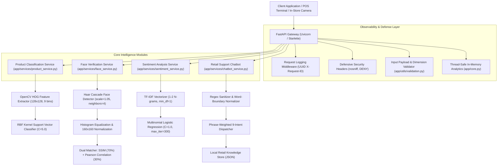

# Smart Retail AI Platform: Architecture & System Design

**Version:** 1.2.0  
**Status:** Production Ready / Offline Verified  
**Canonical Repository:** [1-a-d-i-t-y-a/smart-retail-ai](https://github.com/1-a-d-i-t-y-a/smart-retail-ai)

---

## 1. System Overview

The **AI-Powered Smart Retail & Customer Intelligence Platform** is a resilient, offline-first machine learning application designed for enterprise retail environments. It exposes an asynchronous RESTful gateway built on FastAPI, serving four specialized AI/ML intelligence domains without requiring external paid APIs or cloud dependencies.



---

## 2. Service Architecture & Processing Pipelines

### 2.1 Product Image Classification Service
- **Endpoint:** `POST /classify-product`
- **Objective:** Automated SKU identification and checkout classification across 4 retail categories: `bottle`, `mug`, `headphones`, and `shoe`.
- **Pipeline:**
  1. **Validation:** Checks MIME type (`image/jpeg`, `image/png`, etc.), byte bounds ($10 \text{ bytes} \le \text{size} \le 5 \text{ MB}$), and matrix dimensions ($10 \times 10 \le \text{pixels} \le 4096 \times 4096$).
  2. **Decoding:** Safe buffer decoding via `cv2.imdecode`.
  3. **Feature Extraction:** Histogram of Oriented Gradients (HOG) computes gradient histograms:
     - Window size: $(128, 128)$
     - Block size: $(32, 32)$
     - Cell size: $(16, 16)$
     - Histogram bins: $9$
     - Feature vector dimension: $1,764$ floating-point features.
  4. **Inference:** Radial Basis Function (RBF) Support Vector Machine (`SVC`) computes posterior class probabilities via Platt scaling.
  5. **Fault Tolerance:** If the model artifact is absent, returns HTTP 503 rather than crashing the process.

### 2.2 Customer Face Verification Service
- **Endpoint:** `POST /recognize-face`
- **Objective:** Lightweight customer recognition and VIP loyalty check-in simulation.
- **Educational / Demo Scope:** Intended for non-biometric demonstration. Employs classic computer vision rather than deep neural embeddings to remain lightweight and fully local.
- **Pipeline:**
  1. **Face Detection:** OpenCV Haar Cascade Classifier (`haarcascade_frontalface_default.xml`) scans the grayscale image using multi-scale search ($\text{scaleFactor}=1.05, \text{minNeighbors}=4, \text{minSize}=(40, 40)$).
  2. **Region-of-Interest Extraction:** The largest detected bounding box is cropped, resized to $(160, 160)$, and contrast-equalized via histogram equalization.
  3. **Similarity Formulation:**
     $$\text{Combined Similarity} = 0.70 \times \text{SSIM}(Q, R) + 0.30 \times \left(\frac{\text{Corr}(Q, R) + 1.0}{2.0}\right)$$
     where $\text{SSIM}$ represents the Structural Similarity Index between query $Q$ and reference $R$, and $\text{Corr}$ is the Pearson product-moment correlation coefficient.
  4. **Decision Boundary:** Threshold $\tau = 0.50$. Distances are defined as $d = \max(0, 1.0 - \text{Similarity})$.

### 2.3 Customer Sentiment Analysis Service
- **Endpoint:** `POST /analyze-sentiment`
- **Objective:** Real-time customer feedback categorization into `positive`, `neutral`, or `negative`.
- **Pipeline:**
  1. **Input Sanitization:** Enforces non-blank validation via Pydantic; strips whitespace and limits string length to 5,000 characters.
  2. **Tokenization & Vectorization:** Scikit-learn `TfidfVectorizer` computes unigram and bigram TF-IDF representations.
  3. **Classification:** Regularized Logistic Regression ($L_2$ penalty, $C=1.0$, `max_iter=300`) produces calibrated class probabilities.

### 2.4 Retail Chatbot Service
- **Endpoint:** `POST /chatbot`
- **Objective:** High-speed, deterministic customer support intent classification across 9 operational categories:
  1. `greeting` (salutations, welcomes)
  2. `order_status` (tracking numbers, shipment updates)
  3. `shipping` (delivery timelines, courier info)
  4. `returns` (item returns, size exchanges)
  5. `refunds` (refund timelines, payment reversals)
  6. `store_info` (opening hours, location, address)
  7. `products` (catalog recommendations, comparisons)
  8. `payment` (payment methods: cards, UPI, COD)
  9. `support` (human agent contact, escalation)
  10. `fallback` (graceful recovery for out-of-scope queries)
- **Design Philosophy:** Uses weighted regex phrase matching over `data/chatbot/retail_knowledge.json`. Eliminates hallucinations, zero external API latency, and zero token costs.

### 2.5 Operational Dashboard Service
- **Endpoint:** `GET /dashboard/stats`
- **Objective:** In-process system analytics aggregating throughput across all modules.
- **Concurrency:** Thread-safe counter updates mediated by Python `threading.Lock`. Counters only increment upon successful inference completion, insulating metrics from invalid client requests.

---

## 3. Directory Layout

```text
smart-retail-ai/
├── app/
│   ├── api/                  # FastAPI router definitions
│   │   ├── routes_chatbot.py
│   │   ├── routes_dashboard.py
│   │   ├── routes_face.py
│   │   ├── routes_product.py
│   │   └── routes_sentiment.py
│   ├── schemas/              # Pydantic input/output contracts
│   │   └── api.py
│   ├── services/             # Core ML and business logic
│   │   ├── chatbot_service.py
│   │   ├── face_service.py
│   │   ├── product_service.py
│   │   └── sentiment_service.py
│   ├── utils/                # Feature extraction & validation helpers
│   │   ├── image_features.py
│   │   └── validation.py
│   ├── config.py             # Central application configuration
│   ├── core.py               # Shared thread-safe counters
│   ├── main.py               # Application factory & OpenAPI definition
│   └── observability.py      # Request ID & latency logging middleware
├── artifacts/                # Verified evaluation metrics, confusion matrices
├── data/
│   ├── chatbot/              # Local knowledge JSON
│   ├── evaluation/           # Held-out test splits and challenge sets
│   ├── haarcascades/         # Bundled Haar XML cascade fallback
│   └── training/             # Deterministic training datasets
├── docs/                     # Comprehensive architecture and release docs
├── models/                   # Serialized ML models (.joblib, .pkl)
├── scripts/
│   ├── build_all_models.py   # One-command build & evaluation entrypoint
│   ├── generate_datasets.py  # Synthetic dataset generator (seed 42)
│   ├── train_baseline_models.py
│   └── evaluate_models.py
├── tests/                    # 52 automated tests covering all modules
├── Dockerfile                # Multi-stage production container
├── docker-compose.yml        # Multi-container orchestration specification
└── requirements.txt          # Pinned runtime dependencies
```
