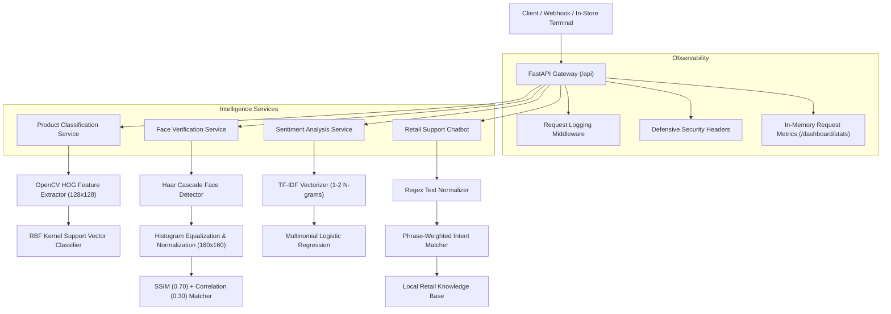

# Smart Retail AI Platform: Architecture & Design

## 1. System Overview

The **AI-Powered Smart Retail & Customer Intelligence Platform** is an offline-first, reproducible machine learning service designed for retail environments. It integrates four core operational domains into a unified RESTful gateway powered by FastAPI:

---

## 2. Service Deep Dive

### 2.1 Product Classification
* **Input:** Raw image binary (JPEG/PNG, max 5MB).
* **Pipeline:**
  1. Image validation & decoding (`cv2.imdecode`).
  2. Resize to 128x128 grayscale.
  3. Extract Histogram of Oriented Gradients (HOG) with window (128,128), block (32,32), cell (16,16), 9 histogram bins.
  4. Radial Basis Function (RBF) Support Vector Machine (`SVC`) classifies product into one of 4 categories: `bottle`, `mug`, `headphones`, `shoe`.
  5. Calibrated probability estimate returned with class label.

### 2.2 Face Verification
* **Input:** Raw image binary.
* **Pipeline:**
  1. Haar Cascade detects primary face region.
  2. Detected face region cropped, normalized to 160x160 pixels, and contrast-enhanced via histogram equalization.
  3. Hybrid similarity metric computed against registered database:
     $$\text{Similarity} = 0.70 \times \text{SSIM} + 0.30 \times \left(\frac{\text{PearsonCorr} + 1.0}{2.0}\right)$$
  4. Decision threshold set at 0.52 for positive identity match.

### 2.3 Sentiment Analysis
* **Input:** Retail customer review text.
* **Pipeline:**
  1. Sub-linear TF-IDF vectorization with unigram and bigram tokenization.
  2. Multinomial Logistic Regression model trained on retail feedback benchmarks.
  3. Classifies text into `positive`, `neutral`, or `negative`.

### 2.4 Retail Chatbot
* **Input:** User query string.
* **Pipeline:**
  1. Text lowercased, punctuation stripped, whitespace collapsed.
  2. Multi-term weighted phrase scanning across 8 retail support domains: `greeting`, `order_status`, `shipping`, `returns`, `store_info`, `products`, `payment`, `support`.
  3. Top-scoring intent routed to pre-compiled retail knowledge base. Unmatched queries routed to defensive fallback.
